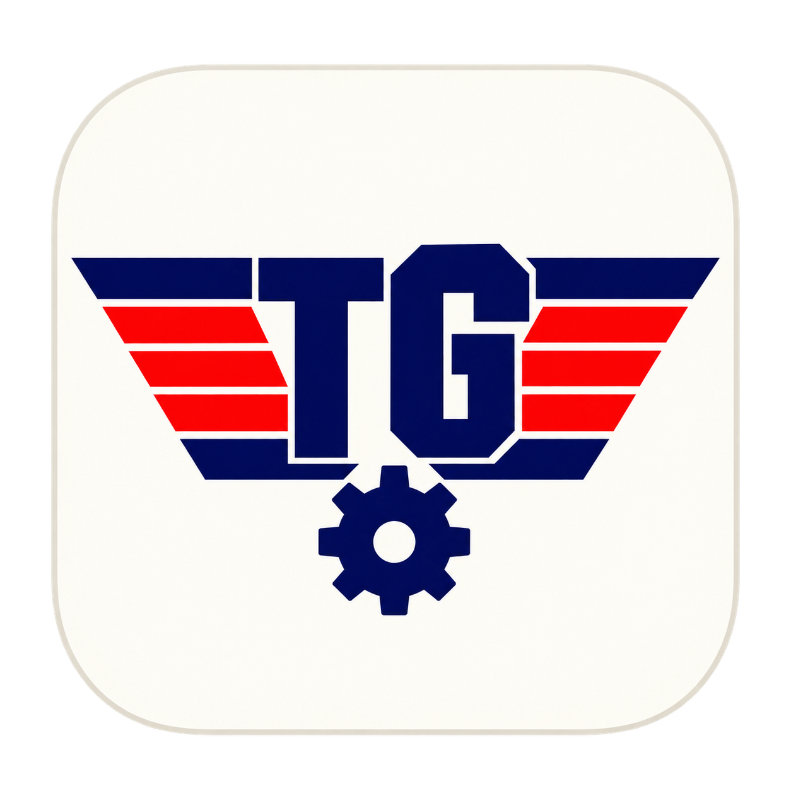

# Topgrade for Alfred

**English** · [Русский](docs/README.ru.md) · [简体中文](docs/README.zh-CN.md)

Run `topgrade` from Alfred in one reusable terminal session. Ghostty is preferred;
if Ghostty is missing or too old, the workflow uses macOS Terminal.app.

- First run creates a dedicated Ghostty tab or Terminal window.
- Repeated requests while updating are ignored, without a queue or extra terminals.
- After completion, the next request runs in that same session.
- Closing the session allows the next request to create a new one.
- Reusing a session does not change focus. New Ghostty tabs briefly take focus before
  the previous tab and pane are restored.

## Install on a new Mac

You need Alfred 5 with **Powerpack**, Python 3.9+, and Topgrade. With Homebrew installed:

```sh
brew install python topgrade
brew install --cask alfred
```

Ghostty is optional:

```sh
brew install --cask ghostty
```

1. Download [Topgrade.alfredworkflow](https://github.com/Matrix6892/alfred-topgrade/releases/latest/download/Topgrade.alfredworkflow).
2. Open the downloaded file and import it into Alfred.
3. Run `topgrade` in Alfred when you want to update software. On the first run,
   allow Alfred to control the selected terminal app when macOS asks.

If Ghostty is not installed, nothing else needs configuring: Terminal.app is used.
Updates follow your existing Topgrade settings and may ask for a sudo password.

## Install or update from source

```sh
git clone https://github.com/Matrix6892/alfred-topgrade.git
cd alfred-topgrade
python3 install.py --dry-run
python3 install.py
```

The installer finds Alfred's active preferences, including a synced location. It
replaces only this workflow and preserves the previous folder in
`Topgrade Workflow Backups` beside the preferences bundle. Other workflows and
Topgrade settings are left intact. Close the dedicated Topgrade session before
updating the workflow so the next run loads the new code.

For a custom location:

```sh
python3 install.py --preferences "/path/to/Alfred.alfredpreferences"
```

## Behavior and options

Ghostty 1.3.1+ provides native tab creation. Terminal.app's supported scripting API
creates a **window**, so the fallback keeps one reusable dedicated window. Initial
creation may bring the terminal app forward; repeated runs leave focus alone.
The session is dedicated to Topgrade and waits between runs rather than offering a
normal shell prompt. Output remains available in the terminal's scrollback.

The workflow uses your `~/.local/bin/topgrade` wrapper when present, otherwise finds
Topgrade in PATH or standard Homebrew locations. It does not copy the original
machine's settings or enforce automatic confirmations. Configure Topgrade normally
in `~/.config/topgrade.toml` if needed.

Optional Alfred workflow environment variables:

| Variable | Purpose |
| --- | --- |
| `TOPGRADE_TERMINAL` | `auto` (default), `terminal`, or `ghostty` |
| `TOPGRADE_BINARY` | Absolute path to a custom executable or wrapper |
| `TOPGRADE_PYTHON` | Absolute path to Python 3.9+ if installed elsewhere |

A live session keeps its current terminal app. Close it before switching backends.
Restored Ghostty sessions start idle; restoring a window does not request an update.

## Troubleshooting and removal

- **Automation denied:** System Settings → Privacy & Security → Automation → Alfred;
  enable Ghostty or Terminal as appropriate. An automation error does not silently
  reroute an update to another app.
- **Session not responding:** close only the dedicated Topgrade tab/window and retry.
- **Python missing:** install Python with Homebrew, or set `TOPGRADE_PYTHON`.
- **Ghostty opens a separate window:** tabs are unavailable in some non-native
  fullscreen modes. Exit that mode before launching.
- **Remove:** close the dedicated session, then delete the Topgrade workflow in
  Alfred Preferences. No service or login item is installed.

Diagnostic state is stored in `~/Library/Caches/topgrade-alfred/`. This folder is
local to the machine and is not part of the repository or release.

## Development and verification

No pip packages are required:

```sh
python3 -m unittest discover -s tests -v
python3 scripts/build.py
```

The internal `workflow/run.sh --check` mode checks the version without updating
software. It is available for development only, with no Alfred keyword.

The build produces `dist/Topgrade.alfredworkflow` with reproducible archive contents.
Tests cover duplicates, reuse, failures, cleanup, idle restoration, fallback,
binary discovery, installation backups and package reproducibility. GitHub checks
run on macOS; they compile the Terminal script and never perform real updates.

Ghostty's scripting API has been checked against 1.3.1. The runtime and installer
are tested separately from the terminal UI. A real Terminal.app version check
verified creation and reuse with the same session, window count and selected window.
Full interactive updates and a full
application restart remain manual checks; they are not performed by the test suite.
See [runtime details](docs/ARCHITECTURE.md) for the contracts and limitations.

## License and credits

GPL-3.0-only. The icon adapts Topgrade's original identity for Alfred.
See [credits](CREDITS.md) and the [icon prompt](docs/ICON.md).
